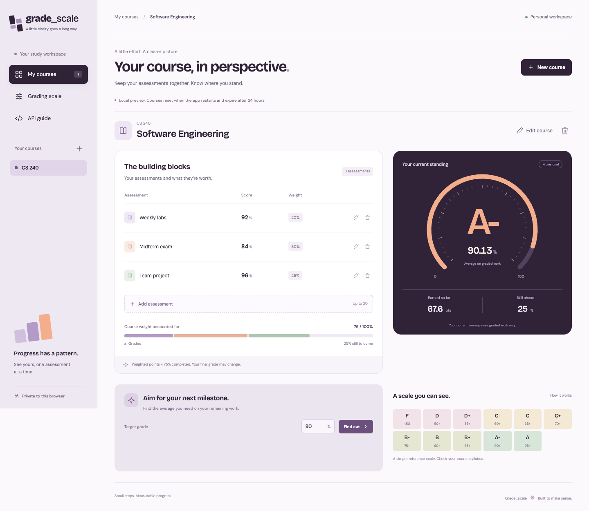

# Grade_scale

A Java REST API and a visual workspace for weighted course grades. Create a
course, add assessment scores and weights, and see your current average, earned
points, and remaining work. Results are provisional until weights reach 100%.

The interface uses a plum, lavender, peach, and mint palette, an animated SVG
grade dial, editable assessments, keyboard-accessible dialogs, and a mobile layout.
Everything is served by one Spring Boot application.



[View the mobile interface](docs/screenshots/mobile.png).

## Start without Docker

Requires **Java 21 or newer**. Maven is downloaded and checksum-verified by the
included wrapper. No Node installation is needed to run the application.

```bash
./scripts/preview.sh
```

Open **http://localhost:8081/**. Click **Try an example** or create a course.
The preview keeps courses in memory; restarting it resets them. Courses expire
within 24 hours. Stop it with **Ctrl+C** in the terminal running the preview.
The launcher caps the Java heap at 192 MB; total process memory is higher.

Windows: use `mvnw.cmd package`, then
`java -Xms32m -Xmx192m -jar target/grade-scale.jar --spring.profiles.active=preview`.

## Run with MySQL and Docker

Start Docker Desktop, then:

```bash
cp .env.example .env
docker compose up --build -d --wait
```

Open the same URL. Stop the native preview first if port 8081 is occupied.
Compose runs a dedicated MySQL user, the Java app, and a named database volume.
It publishes only the app, bound to your own Mac; MySQL has no host port.
The sample passwords are for local development only.

```bash
docker compose logs -f app
docker compose stop    # Stop app and database; keep saved data
docker compose down    # Remove containers; keep the database volume
```

Quit Docker Desktop to release its virtual machine's RAM. Avoid `down -v` unless
you intend to delete the database. MySQL stores courses, assessments, and browser
sessions, so a valid session can resume after restarting the app.

## What you can do

- Create, rename, and delete up to 20 courses per browser workspace.
- Add, edit, and remove up to 20 assessments per course.
- Enter percentage scores and weights with up to two decimal places.
- See weighted contributions and a proportional weight bar.
- Get a final-score target for the remaining course weight.
- Read the grading scale and API guide inside the app.
- Keep courses private to the browser session, with CSRF protection on changes.

## The calculation

```text
Assignments: 80% score × 40% weight = 32 points
Final exam:  90% score × 60% weight = 54 points
Final grade: 86% → B+
```

When weights are below 100%, current average = earned points / completed weight
× 100. The final result remains **provisional**. An empty course has no grade.
Scores round half-up to two decimals before assigning a letter.

| Letter | Percentage |
| ------ | ---------- |
| A      | 95–100     |
| A-     | 90–94.99   |
| B+     | 85–89.99   |
| B      | 80–84.99   |
| B-     | 75–79.99   |
| C+     | 70–74.99   |
| C      | 65–69.99   |
| C-     | 60–64.99   |
| D+     | 55–59.99   |
| D      | 50–54.99   |
| F      | Below 50   |

This is a reference scale, not a claim about any school's grading policy.

## Stack and structure

Java 21-compatible source, Spring Boot 4.1.2, Spring Web MVC, Spring Security,
Spring JDBC `JdbcTemplate`, MySQL, and TestNG. A documented initial SQL schema
keeps this small project simple. There is no JUnit, Flyway, or ORM layer.

```text
src/main/java/dev/bagdaulet/gradescale/
  ApiController.java             REST endpoints
  Models.java                    Request and response records
  GradeCalculator.java           Decimal grade and target arithmetic
  CourseRepository.java          Small persistence interface
  PreviewCourseRepository.java   Lightweight in-memory preview
  MysqlCourseRepository.java     SQL queries and transactions
  MysqlConfiguration.java        Database and persistent session configuration
  SecurityConfiguration.java     CSRF, cookies, response headers
  RequestLimits.java             Bounded requests and local rate limiting
src/main/resources/
  static/                        HTML, custom CSS, JavaScript, bundled fonts
  schema.sql                     MySQL tables and constraints
src/test/                        TestNG calculation and real HTTP tests
scripts/                         Preview launcher and browser journey
.github/workflows/               CI and manual container export
```

The frontend uses plain HTML, CSS, and JavaScript, with no frontend framework or
runtime CDN. Custom CSS makes its design independent of Bootstrap's defaults.
Font licenses are included in `src/main/resources/static/fonts/`.

## Development checks

```bash
./mvnw -B -ntp fmt:check verify
npm ci --ignore-scripts
npm audit
npm run format:check
BROWSER_CHANNEL=chrome npm run test:browser
```

Node 22+ is only needed for development tools. Browser checks expect the app at
`http://localhost:8081/` and an installed Chrome browser. Set `BASE_URL` for another
address. For bundled Playwright Chromium, run `npx playwright install chromium`
and omit `BROWSER_CHANNEL`.

To format: `./mvnw fmt:format` and `npm run format`.
To run the API tests against an existing MySQL instance, provide `MYSQL_HOST`,
`MYSQL_PORT`, `MYSQL_DATABASE`, `MYSQL_USER`, and `MYSQL_PASSWORD`, then run
`TEST_STORAGE=mysql ./mvnw test`. Use a dedicated test database.

## CI and delivery

The CI workflow is ready for a future repository: it tests Java against MySQL,
checks frontend formatting and dependencies, runs a browser journey, and builds
the Docker image. A separate manual workflow exports an image artifact.
It does not publish an image or deploy to a server automatically.

No GitHub repository or remote is configured for this local project.

[API](docs/api.md) · [Architecture](docs/architecture.md) ·
[Security](docs/security.md) · [Verification](docs/verification.md)
